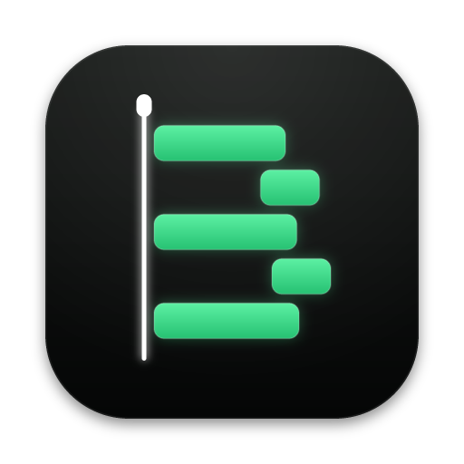

<p align="center">
  
</p>

<h1 align="center">Beacon</h1>

<p align="center">
  <b>The screen-recording editor your AI agent can drive.</b><br>
  Record, cut and export on your Mac, by hand or through MCP.
</p>

> [!WARNING]
> **Beacon is very early alpha software.** Expect bugs, missing features and
> things that break between versions; formats and commands may still change.
> Keep your own copies of anything you edit with it, and please
> [open an issue](https://github.com/Orva-Studio/beacon/issues) when something
> goes wrong.

Beacon by Orva is a macOS screen-recording editor on its own project format
and renderer, built so every edit can be automated. Personal project: macOS
26+ on Apple silicon only.

## Features
- **Every edit is an MCP tool.** Beacon ships its own MCP server
  (`beacon-mcp`, inside the app) with about 150 tools: import, cut, trim, zoom,
  animate, add effects and annotations, read transcripts, remove silences,
  look at frames and export. An agent can edit a project on its own, or the
  one open in the app, live on its timeline and sharing your undo history.
- **Record your screen, camera and microphone** (and system audio) straight
  into a project, with the cursor recorded separately so it can be smoothed,
  enlarged or hidden later.
- **A timeline editor:** tracks, clips, ripple cuts, speed, linked audio,
  animations, zooms, effects, text and shape annotations, blur and spotlight.
- **Transcripts and Remove Silences:** speech is transcribed on your Mac by
  Whisper; the AI panel marks every silence on the timeline for you to review
  and removes them in one undo step, keeping the ones with screen action.
- **Fast export:** MP4 and MOV (H.264, HEVC, ProRes) encoded by VideoToolbox
  straight from the GPU, plus GIF and WebM. Preview and export draw the same
  frames, through Beacon's Rust/wgpu renderer.
- **Opens Camtasia work:** reads `.trec` recordings and imports `.cmproj`
  projects (read only; nothing is written back).
- **Self-contained:** the app carries its own FFmpeg and whisper-cli, so
  there's nothing else to install; projects can be made standalone, with their
  media inside, to move or share.

## Install
Download `beacon-macos-arm64.dmg` from the
[latest release](https://github.com/Orva-Studio/beacon/releases/latest), open
it and drag Beacon to Applications. It carries everything it needs (its own
FFmpeg and whisper-cli); the speech model for transcripts is downloaded the
first time you ask for one. Beacon isn't signed with a Developer ID yet, so
macOS refuses to open it until its quarantine flag is cleared (step 3 below),
and it asks again for screen recording, camera and microphone permission after
each update.

Or paste this into an AI agent such as Claude Code:

```text
Install Beacon, a macOS screen-recording editor, on this Mac (Apple silicon):
1. In a new temporary folder (`cd "$(mktemp -d)"`), download the DMG and its
   checksums from the latest release with curl (no other tools needed):
   `curl -fLO https://github.com/Orva-Studio/beacon/releases/latest/download/beacon-macos-arm64.dmg
   -fLO https://github.com/Orva-Studio/beacon/releases/latest/download/checksums.txt`,
   and check it: `grep beacon-macos-arm64.dmg checksums.txt | shasum -a 256 -c`.
2. Quit Beacon if it is running. Mount the DMG (`hdiutil attach -nobrowse`), copy
   Beacon.app to /Applications (replacing an older one), and detach it.
3. Beacon isn't signed with a Developer ID yet, so clear the quarantine flag:
   `xattr -dr com.apple.quarantine /Applications/Beacon.app`.
4. Open it once: `open /Applications/Beacon.app`. Its first launch unpacks the
   app in place; wait until
   /Applications/Beacon.app/Contents/Resources/app/engine/beacon-mcp exists,
   then quit it: `osascript -e 'quit app "Beacon"'`.
5. Add its MCP server (replacing an existing `beacon` one):
   `claude mcp add -s user beacon -- /Applications/Beacon.app/Contents/Resources/app/engine/beacon-mcp`.
Then tell me two things: Beacon's tools appear in Claude Code sessions started
from now on (not this one), and until Beacon is signed, macOS asks again for
screen recording, camera and microphone permission after each update.
```

Each AI tool starts its own `beacon-mcp` when a session begins; the app
needn't be running. To use Beacon from another MCP client (Claude Desktop,
Cursor…), point its MCP config at the same
`/Applications/Beacon.app/Contents/Resources/app/engine/beacon-mcp`. With the
app open on a project, `project_open` connects to it: the agent's edits show
on its timeline, sharing your undo history.

## Update
From 0.4.0, Beacon checks for a new version a little after it opens, and
**Beacon › Check for Updates…** checks now; when there is one, **Update and
Restart** downloads it, saves your projects and restarts into it. Updated this
way, there's no quarantine flag to clear. Until Beacon is signed, macOS asks
again for screen recording, camera and microphone permission after each update.

To update from an agent instead (or from 0.3.0 and earlier), paste this:

```text
Update Beacon on this Mac to the latest release of github.com/Orva-Studio/beacon.
In a new temporary folder (`cd "$(mktemp -d)"`), download the DMG and its
checksums with curl (`curl -fLO
https://github.com/Orva-Studio/beacon/releases/latest/download/beacon-macos-arm64.dmg
-fLO https://github.com/Orva-Studio/beacon/releases/latest/download/checksums.txt`)
and check it (`grep beacon-macos-arm64.dmg checksums.txt | shasum -a 256 -c`). Quit Beacon (`osascript -e 'quit app "Beacon"'`), mount the
DMG (`hdiutil attach -nobrowse`), replace /Applications/Beacon.app with its
Beacon.app, detach it, and run `xattr -dr com.apple.quarantine
/Applications/Beacon.app`. Open it once (`open /Applications/Beacon.app`) so it
unpacks, wait until
/Applications/Beacon.app/Contents/Resources/app/engine/beacon-mcp exists, then
quit it. The MCP server's path doesn't change, so `claude mcp` needs nothing.
```

## Requirements (to build it)
- [Bun](https://bun.sh) 1.4
- Rust via rustup (the toolchain is pinned in `packages/engine/rust-toolchain.toml`)
- pkg-config and cmake: `bun run build` builds Beacon's own FFmpeg and
  whisper-cli from pinned sources (it uses `nix shell` when they're missing)

## Getting started
```sh
bun install
bun run build        # the Rust engine; needed before anything reads media
bun run app          # build and open the editor
```
`BEACON_PROJECT=path/to/x.beproj bun run app` opens a project, and
`BEACON_BACKGROUND=1` starts the app without taking focus.

## Driving it with an agent
`.mcp.json` runs the MCP server from source, so Claude Code in this repo has
the `beacon` tools. To use it elsewhere, run `bun run mcp`, or
`bun run build:mcp` for a standalone `dist/beacon-mcp` (with the engine and
Beacon's tools beside it, as in the app). If the app has the
project open, `project_open` connects to it and the edits show on its timeline.
The server's built-in instructions are in `skills/SKILL.md`.

## Commands
| | |
|-|-|
| `bun run test` | Bun and cargo tests (the app test launches the app) |
| `bun run typecheck` | TypeScript across the workspace |
| `bun run audit` | `bun audit` and `cargo deny` |
| `bun run render-cmproj <project.cmproj> <out.mp4>` | Headless render of a `.cmproj` project |
| `bun run dump-trec [root]` | Read every `.trec` under a folder |

Tests on real media read it from `BEACON_FIXTURES` (default `~/beacon-fixtures`):
`project.cmproj`, `small.cmproj`, `recording.trec`, `recording-2.trec`,
`video.mp4`, `video-2.mp4`, `video-3.mp4`, `audio.m4a`, `image.png` and
`take.brec` (a take from `beacon-recorder`). A test
whose file is missing is skipped.

`scripts/ui-harness/` serves the editor UI to headless Chromium against a real
core, for clicking, dragging and screenshotting without a window.

## Releasing
`bun run release 0.2.0` on a clean, up-to-date `main` sets the version in
every `package.json` (the app takes the root's), commits
`chore(release): v0.2.0`, tags `v0.2.0` and pushes, as hance does. The tag
runs `.github/workflows/release.yml`, which builds the app, checks the DMG and
publishes `beacon-macos-arm64.dmg`, `checksums.txt` and FFmpeg's source,
configure patch and options as a GitHub release. Locally,
`bun run --cwd packages/desktop package` builds the DMG into
`packages/desktop/artifacts`, and `bun scripts/check-release.ts <dmg>` checks it
as a Mac without Homebrew would see it: both apps signed (ad hoc until there is
a Developer ID), nothing linked from outside the app, and the app's own
`beacon-mcp` exporting MP4 and GIF with nothing on PATH.

## Layout
`packages/` holds the TypeScript workspaces (`model`, `features`, `core`,
`render`, `media`, `camtasia`, `mcp`, `ui`, `desktop`) and the Rust engine
(`engine`). Features are folders that register with the core; the core never
names a feature.

- [`PLAN.md`](PLAN.md): scope, architecture, phases and status
- [`ARCHITECTURE.md`](ARCHITECTURE.md): what exists today
- [`docs/formats/`](docs/formats): file formats Beacon reads

## Contributing
Beacon takes issues, not pull requests: see [`CONTRIBUTING.md`](CONTRIBUTING.md).

## License
[FSL-1.1-ALv2](LICENSE): free to use, modify and redistribute, but not to
build a competing product or service. Each version becomes Apache 2.0 two
years after it is released. Third-party notices are in
[`THIRD_PARTY_NOTICES`](THIRD_PARTY_NOTICES).
